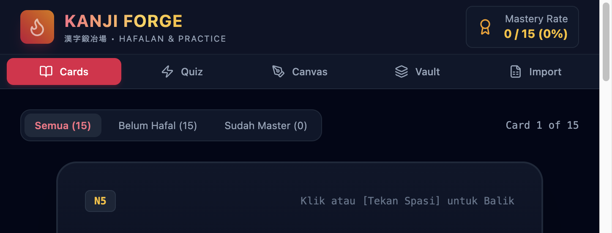

# KanjiForge

A web app for practicing Japanese kanji with flashcards, quizzes, a writing canvas, and a personal kanji library.



## Run locally

### Requirements

- Go 1.26 or later
- Node.js 20 or later and npm

### Start the app

```bash
git clone https://github.com/lailaKho753/KanjiForge.git
cd KanjiForge
npm install
npm run build
go run .
```

Open [http://localhost:8080](http://localhost:8080) in your browser.

For frontend development with hot reload, run the Go server in one terminal and
start Vite in another:

```bash
npm run dev
```

Open the URL printed by Vite. API requests are proxied to the Go server.

> **Note:** Version 1 of KanjiForge is available on the [`v1` branch](https://github.com/lailaKho753/KanjiForge/tree/v1).
